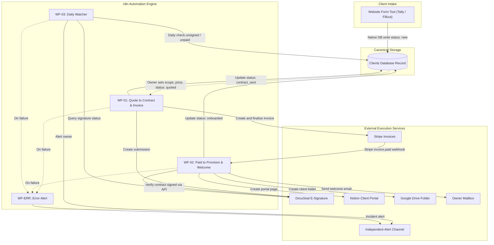
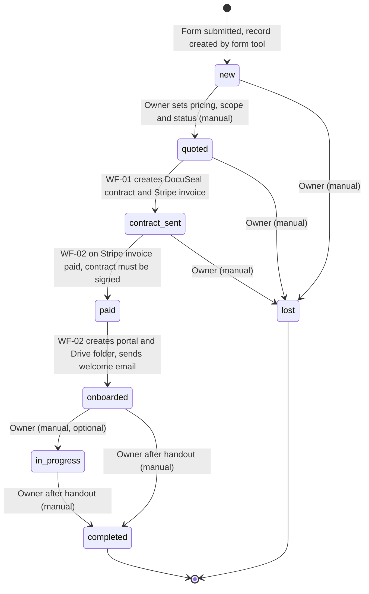

# Automation Architecture — Lean Client Onboarding System

## 1. Purpose & Scope

The **Lean Client Onboarding System** automates the repetitive, error-prone onboarding steps for a solo consultancy: generating contracts and invoices, provisioning client portals and shared folders upon payment, and sending the welcome email. All scoping, pricing, and project handouts remain intentional human actions.

## 2. Principles

1. **Single source of truth**: The database record is canonical; Notion, Drive, DocuSeal, and Stripe are projections or executors, never masters.
2. **Human decides, machine executes**: The owner decides pricing, scope, and handouts; automation handles the mechanical execution.
3. **Idempotent by field**: Every side effect is guarded by its own stored identifier or URL; re-running never duplicates resources.
4. **Lean by default**: Fewer moving parts beats wider coverage; automates only high-friction steps.

## 3. High-Level System Overview

## 4. Lifecycle & Status Transitions

*Note: `signed_at` is a timestamp field, not a lifecycle status.*

## 5. Workflow Catalog

| ID | Workflow | Trigger | Core Actions | Guard & Failure Behavior |
| :--- | :--- | :--- | :--- | :--- |
| **WF-01** | Quote to Contract & Invoice | Status = `quoted` AND `docuseal_submission_id` empty | Validates fields; creates DocuSeal contract; creates & sends Stripe invoice; sets status = `contract_sent`. | Skip DocuSeal if ID set; skip Stripe if invoice ID set. Alerts owner on missing fields. |
| **WF-02** | Paid to Provision & Welcome | Stripe `invoice.paid` event OR manual trigger with `client_id` | Verifies signed contract; sets status = `paid`; creates Notion portal; creates Drive folder; sends welcome email; sets status = `onboarded`. | Stop if contract unsigned (alert owner). Skip Notion, Drive, or email if respective URLs/timestamps exist. |
| **WF-03** | Daily Watcher | Daily schedule (e.g. 09:00 UTC) | Checks `contract_sent` records; syncs `signed_at` via DocuSeal API; alerts owner if unsigned > 3 days or unpaid > 7 days. | Read-only check; never contacts clients or provisions resources. |
| **WF-ERR** | Error Alert | n8n Error Trigger | Catches runtime failures; dispatches details (workflow, node, client reference, error message) to independent alert channel. | 3 retries with exponential backoff on external API nodes before failure. |

## 6. Manual Steps & Field Ownership

### 6.1. Explicit Manual Actions

| Step | Who | Notes |
| :--- | :--- | :--- |
| Reply to the lead personally | Owner | Directly from owner mailbox |
| Set pricing, scope, currency, `status = quoted` | Owner | Deliberate human checkpoint; triggers WF-01 |
| Chase signature / payment after an alert | Owner | Follow-up directly with prospective client |
| Update the Notion portal during the project | Owner | Manual updates; no task-tool synchronization |
| Set `status = in_progress` | Owner | Optional milestone marker |
| Verify final payment before handout | Owner | Checklist item in runbook |
| Handout: GitHub transfer/invite, upload to Drive | Owner | Manual; irreversible actions are not automated |
| Set `status = completed`, `completed_at`, `handout_method` | Owner | Closeout |
| Set `status = lost` | Owner | Archive |

### 6.2. Field Ownership

| Writer | Owned Fields |
| :--- | :--- |
| **Form Tool** | `name`, `email`, `company`, `message`, `service_interest`, `source`, `status = new` |
| **Owner (Manual)** | `services`, `price`, `currency`, `payment_terms`, `notes`, `handout_method`, `repo_url`, `completed_at`, manual status flips (`quoted`, `in_progress`, `completed`, `lost`) |
| **WF-01** | `docuseal_submission_id`, `stripe_invoice_id`, `stripe_invoice_url`, `status = contract_sent` |
| **WF-02** | `paid_at`, `status = paid`, `portal_url`, `drive_url`, `welcome_sent_at`, `status = onboarded` |
| **WF-03** | `signed_at` |

## 7. Data Model Pointer

The data model is a single flat table (`clients`). Complete field definitions, types, and schema specifications are documented in [`docs/database-schema.md`](./docs/database-schema.md).

## 8. External Integrations

| Service | Role | Auth Method | Used By |
| :--- | :--- | :--- | :--- |
| **Database** (Airtable / Notion) | Single source of truth for all client state | API Token (n8n credential) | Form tool, WF-01, WF-02, WF-03 |
| **DocuSeal** | Contract e-signature and PDF execution | API Key (REST API) | WF-01, WF-02, WF-03 |
| **Stripe** | Invoicing and payment processing | Restricted API Key (`rk_live_...`) | WF-01, WF-02 |
| **Notion** | Client portal page generation | Internal Integration Token | WF-02 |
| **Google Drive** | Per-client file sharing folder | OAuth2 / Service Account | WF-02 |
| **Owner Mailbox** | Transactional welcome email dispatch | SMTP / Gmail OAuth2 | WF-02 |
| **Alert Channel** (Telegram / Slack) | Independent operational error alerts | Bot Token / Webhook URL | WF-03, WF-ERR |

## 9. Security & Least Privilege

* **Secret Isolation**: Secrets reside strictly in the n8n credential vault; exported files strip credentials.
* **Stripe Least Privilege**: Restricted API key scoped strictly to Customers and Invoices. Webhook signatures are verified.
* **DocuSeal Outbound Only**: DocuSeal is queried strictly via REST API; no inbound webhook is exposed.
* **Client-Safe Projections**: The Notion portal contains only client-facing milestones; internal pricing notes remain in the database.
* **Drive Access**: Folders are shared per client with minimum necessary viewer/editor permissions.
* **Zero Credential Transmission**: Intake requests never ask for passwords by email; clients are directed to a password manager secure share.

## 10. Failure Handling

| Scenario | Detection | Automated Action | Manual Recovery |
| :--- | :--- | :--- | :--- |
| WF-01 partial failure (DocuSeal or Stripe fails) | Node error | Per-field guards prevent duplicate items | Re-run WF-01; missing resource is created |
| Paid but unsigned | WF-02 gate check | WF-02 halts without provisioning; alerts owner | Chase signature; once signed, re-run WF-02 manually |
| Notion or Drive failure in WF-02 | Node error | Per-field guards prevent duplicate items | Re-run WF-02 manually; existing items are skipped |
| Duplicate form submission | Form / DB check | Record created or updated | Owner reviews and merges duplicate leads |
| Quote or scope amended after sending | Manual review | None | Void DocuSeal/Stripe items, clear IDs, set status = `quoted` |

## 11. Environment Variables

| Variable | Purpose |
| :--- | :--- |
| `DOCUSEAL_API_KEY` | DocuSeal REST API access |
| `STRIPE_API_KEY` | Stripe restricted API key |
| `STRIPE_WEBHOOK_SECRET` | Stripe signature verification (if using webhook node) |
| `DATABASE_API_TOKEN` | Database API token for client records |
| `NOTION_INTEGRATION_TOKEN` | Notion API access for portal creation |
| `GOOGLE_OAUTH_CREDENTIALS` | Google Drive API access |
| `OWNER_EMAIL` | Destination for owner notifications |
| `BOOKING_LINK` | Kickoff call booking URL in welcome email |
| `REMINDER_UNSIGNED_DAYS` | Days before unsigned contract alert (default: 3) |
| `REMINDER_UNPAID_DAYS` | Days before unpaid invoice alert (default: 7) |

## 12. Removed and Why

The following legacy components were cut to eliminate unnecessary complexity:
* **Resend**: Replaced by the owner's own mailbox via n8n SMTP/Gmail node for authentic direct communication.
* **GitHub API / GITHUB_TOKEN**: Code handover is an irreversible manual delivery; automated transfers introduced security and repository permission risks.
* **DocuSeal webhook & DOCUSEAL_WEBHOOK_SECRET**: Replaced by synchronous API polling in WF-02 and WF-03, removing public webhook exposure.
* **WF-02 Lead Record Handler**: Removed; Tally/Fillout writes directly to the database and notifies the owner natively.
* **WF-04 Signature & Payment Handler**: Replaced by unified WF-02 triggered directly by Stripe payments.
* **WF-05, WF-06, WF-07, WF-08**: Consolidated provisioning and welcome into WF-02; eliminated automated code transfers and manual status syncing.
* **live status sync, progress_percent, project_status, workflow_log**: No external task source existed to sync; manual portal updates take minutes without database bloat.
* **delivery_ready, status: signed**: Removed redundant statuses; `signed_at` is a field, and handout is handled manually.
* **Automatic acknowledgment / lead notification emails from n8n & HTML templates**: Replaced by form tool native autoresponders and direct owner replies.
* **webhook-contracts.md, invoice-fields.md, LEAD_WEBHOOK_SECRET**: Removed obsolete webhook documentation and redundant field specs.

## 13. Open Decisions / To Verify

1. **Database Engine**: Evaluate Notion Database vs. Airtable for the single flat table. Airtable provides stronger API webhooks; Notion keeps the database co-located with portal pages.
2. **Form Tool Selection**: Evaluate Tally vs. Fillout for direct database insertion and native email notifications.
3. **n8n Hosting Environment**: Self-hosted Docker instance vs. n8n Cloud.
4. **Independent Alert Channel**: Telegram Bot API vs. Slack incoming webhook for out-of-band operational alerts.
5. **Notion Portal API Duplication & Sharing**: Verify whether the Notion API supports native page duplication from a template and programmatic page-level guest sharing, or if the page must be created via block children appending.
6. **Invoice Dispatch Timing**: Confirm whether Stripe invoices should be dispatched immediately with the contract (WF-01) or finalized only after the contract is signed.
7. **Google OAuth Token Refresh**: Verify service account vs. user OAuth2 token lifetime for Google Drive folder creation.
