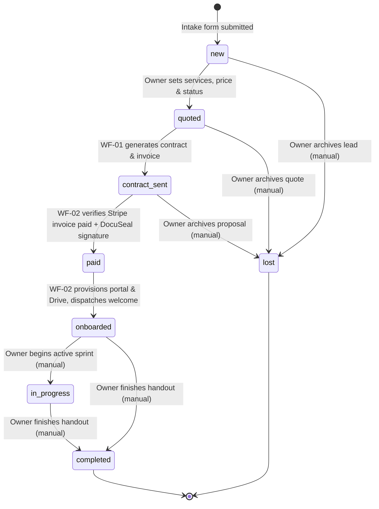

# Database Schema Specification — `clients` Table

The Lean Client Onboarding System uses a **single flat table** named `clients` as the canonical source of truth for all client state. External systems (DocuSeal, Stripe, Notion, Google Drive) are projections or executors, never masters.

This schema is engine-agnostic and can be deployed directly in **Airtable** or **Notion Database**.

---

## 1. Field Specification Table

| # | Field Name | Data Type | Writer | Description / Allowed Values |
| :-: | :--- | :--- | :--- | :--- |
| 1 | `id` | Formula / Autonumber | System | Unique identifier (e.g. `rec_abc123` in Airtable or page ID in Notion) |
| 2 | `created_at` | Created Time | System | Timestamp when record was created by intake form |
| 3 | `name` | Single line text | Form Tool | Primary client contact name |
| 4 | `email` | Email | Form Tool | Primary client email address |
| 5 | `company` | Single line text | Form Tool | Client legal or operating company name |
| 6 | `message` | Long text | Form Tool | Initial inquiry message or project notes from form |
| 7 | `service_interest` | Single select | Form Tool | Selected area of interest from intake form |
| 8 | `source` | Single select / Text | Form Tool | Acquisition channel (e.g. `Referral`, `LinkedIn`, `Search`) |
| 9 | `services` | Long text | Owner (Manual) | Final agreed scope of work (bulleted for contract & portal) |
| 10 | `price` | Number / Currency | Owner (Manual) | Agreed project fee (numeric amount, e.g. `5000.00`) |
| 11 | `currency` | Single select | Owner (Manual) | ISO code: `USD`, `EUR`, `GBP`, `CZK` |
| 12 | `payment_terms` | Single select / Text | Owner (Manual) | Payment structure (e.g. `50% upfront / 50% completion`, `100% upfront`, `Net 14`) |
| 13 | `status` | Single select | Mixed | Current lifecycle state (see Section 2 for exact enum values) |
| 14 | `docuseal_submission_id`| Single line text / Number | WF-01 | DocuSeal submission ID returned from submission API |
| 15 | `signed_at` | Date / Time | WF-03 / WF-02 | Timestamp when contract was verified signed in DocuSeal |
| 16 | `stripe_invoice_id` | Single line text | WF-01 | Stripe invoice ID (`in_...`) |
| 17 | `stripe_invoice_url` | URL | WF-01 | Hosted invoice payment URL generated by Stripe |
| 18 | `paid_at` | Date / Time | WF-02 | Timestamp when Stripe `invoice.paid` event was verified |
| 19 | `portal_url` | URL | WF-02 | Link to provisioned Notion client portal page |
| 20 | `drive_url` | URL | WF-02 | Link to provisioned Google Drive shared folder |
| 21 | `welcome_sent_at` | Date / Time | WF-02 | Timestamp when welcome email was dispatched |
| 22 | `notes` | Long text | Owner (Manual) | Private consultant notes (never synced to client portal) |
| 23 | `handout_method` | Single select | Owner (Manual) | Delivery mechanism: `GitHub Transfer`, `GitHub Invite`, `Zip/Drive` |
| 24 | `repo_url` | URL | Owner (Manual) | Link to repository or deliverable location |
| 25 | `completed_at` | Date / Time | Owner (Manual) | Timestamp when project handover was finalized |

---

## 2. Lifecycle Status Values & State Machine

The `status` field strictly accepts the following 8 enum values:

### Status Descriptions
* `new`: Populated exclusively by the intake form tool. Awaiting owner review.
* `quoted`: Set manually by the owner after scoping. Triggers **WF-01**.
* `contract_sent`: Set automatically by **WF-01** after creating DocuSeal submission and Stripe invoice.
* `paid`: Set automatically by **WF-02** once Stripe `invoice.paid` is validated and signature is confirmed.
* `onboarded`: Set automatically by **WF-02** once Notion portal, Drive folder, and welcome email succeed.
* `in_progress`: Optional manual state set by the owner during active project delivery.
* `completed`: Set manually by the owner upon final asset handoff and project sign-off.
* `lost`: Set manually by the owner if an inquiry or quote does not proceed.

> **Crucial Rule**: `signed_at` is a date/time timestamp, **never** a lifecycle status enum. Signature verification is an assertion check in WF-02, not a lifecycle state.

---

## 3. Field Ownership & Access Matrix

| Owner / Writer | Fields Owned | Write Mode |
| :--- | :--- | :--- |
| **Intake Form Tool** (Tally / Fillout) | `name`, `email`, `company`, `message`, `service_interest`, `source`, `status = "new"` | Direct native API insert |
| **Consultant / Owner** (Manual) | `services`, `price`, `currency`, `payment_terms`, `notes`, `handout_method`, `repo_url`, `completed_at`, manual status changes (`quoted`, `in_progress`, `completed`, `lost`) | UI editing (Airtable / Notion) |
| **WF-01** (Quote to Contract/Invoice) | `docuseal_submission_id`, `stripe_invoice_id`, `stripe_invoice_url`, `status = "contract_sent"` | n8n DB Node / REST API |
| **WF-02** (Paid to Provision/Welcome) | `paid_at`, `portal_url`, `drive_url`, `welcome_sent_at`, `status = "paid"`, `status = "onboarded"` | n8n DB Node / REST API |
| **WF-03** (Daily Watcher) | `signed_at` | n8n DB Node / REST API |

---

## 4. Platform Implementation Guides

### Option A: Airtable Setup

1. **Table Name**: `Clients`
2. **Key Views**:
   * **All Leads**: Grid view sorted by `created_at` descending.
   * **Needs Quote**: Filtered where `status` is `new`.
   * **Awaiting Signature / Payment**: Filtered where `status` is `contract_sent`.
   * **Active Projects**: Filtered where `status` is `onboarded` or `in_progress`.
   * **Completed**: Filtered where `status` is `completed`.
3. **Form Integration**: Connect Tally or Fillout via native Airtable integration mapping fields directly.
4. **Trigger Configuration for WF-01**: Use Airtable "Watch Records" trigger in n8n where `status` is `quoted` and `docuseal_submission_id` is empty.

### Option B: Notion Database Setup

1. **Database Name**: `Clients Database`
2. **Properties**: Create matching properties with exact names listed in Section 1.
3. **Relation to Portals**: When WF-02 creates a new Notion page for the client portal, it writes the resulting page URL into `portal_url`.
4. **Trigger Configuration for WF-01**: Use Notion "Watch Database Items" trigger or a scheduled polling node checking for `status == "quoted"` and empty `docuseal_submission_id`.
