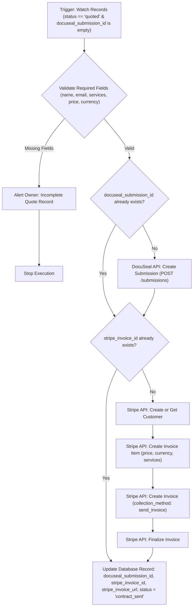

# Workflow Specification: WF-01 — Quote to Contract & Invoice

## 1. Overview & Purpose

**WF-01** automates the generation and delivery of legal agreements and deposit invoices once a project scope and price have been confirmed by the owner.

* **Trigger**: Database polling / record watcher firing when `status == "quoted"` AND `docuseal_submission_id` is empty.
* **Outputs**:
  * DocuSeal contract submission created and dispatched to client.
  * Stripe customer created (or matched), invoice drafted, finalized, and sent.
  * Canonical database record updated with `docuseal_submission_id`, `stripe_invoice_id`, `stripe_invoice_url`, and `status = "contract_sent"`.
* **Idempotency**: Field-level guards prevent recreating DocuSeal contracts or Stripe invoices on retries.

---

## 2. Process Flow Diagram



---

## 3. Node-by-Node Specification

### Node 1: `Trigger_WatchQuotedRecords`
* **Node Type**: Airtable / Notion Node or Schedule Polling Node (`n8n-nodes-base.airtable` / `n8n-nodes-base.notion` / `n8n-nodes-base.scheduleTrigger`)
* **Configuration**:
  * Filter: `status` equals `quoted` AND `docuseal_submission_id` is empty
  * Polling Interval: Every 5 minutes (or webhook trigger if using Airtable automations)
* **Output Payload**: Full client record (`id`, `name`, `email`, `company`, `services`, `price`, `currency`, `payment_terms`, `docuseal_submission_id`, `stripe_invoice_id`).

### Node 2: `Validate_QuoteFields`
* **Node Type**: Code Node (JavaScript)
* **Parameters**:
  ```javascript
  const required = ['name', 'email', 'services', 'price', 'currency'];
  const missing = [];
  for (const field of required) {
    if (!$input.item.json[field]) {
      missing.push(field);
    }
  }
  if (missing.length > 0) {
    return [{
      json: {
        is_valid: false,
        missing_fields: missing,
        client_id: $input.item.json.id,
        name: $input.item.json.name || 'Unknown'
      }
    }];
  }
  return [{
    json: {
      is_valid: true,
      ...$input.item.json
    }
  }];
  ```

### Node 3: `Switch_Validation`
* **Node Type**: `n8n-nodes-base.if`
* **Condition**: `{{ $json.is_valid }} === true`
* **False Branch**: Dispatches alert to owner via `WF-ERR` / independent alert channel and terminates without altering status.

### Node 4: `Guard_DocuSeal`
* **Node Type**: `n8n-nodes-base.if`
* **Condition**: `{{ $json.docuseal_submission_id }} is not empty`
* **True Branch**: Proceeds to Stripe step without calling DocuSeal API.
* **False Branch**: Calls Node 5 (`DocuSeal_CreateSubmission`).

### Node 5: `DocuSeal_CreateSubmission`
* **Node Type**: `n8n-nodes-base.httpRequest`
* **Parameters**:
  * Method: `POST`
  * URL: `https://api.docuseal.com/submissions`
  * Headers:
    * `X-Auth-Token`: `={{ $env.DOCUSEAL_API_KEY }}`
    * `Content-Type`: `application/json`
  * Body Parameters (JSON):
    ```json
    {
      "template_id": {{ $env.DOCUSEAL_TEMPLATE_ID }},
      "send_email": true,
      "submitters": [
        {
          "role": "Client",
          "email": "={{ $json.email }}",
          "name": "={{ $json.name }}",
          "fields": [
            { "name": "Client Company Name", "default_value": "={{ $json.company }}" },
            { "name": "Scope of Services", "default_value": "={{ $json.services }}" },
            { "name": "Contract Value", "default_value": "={{ $json.price.toString() }}" },
            { "name": "Currency", "default_value": "={{ $json.currency }}" },
            { "name": "Payment Terms", "default_value": "={{ $json.payment_terms || '50% upfront, 50% upon completion' }}" }
          ]
        }
      ]
    }
    ```
  * Retry on Fail: 3 times, exponential backoff (2000ms).

### Node 6: `Guard_Stripe`
* **Node Type**: `n8n-nodes-base.if`
* **Condition**: `{{ $json.stripe_invoice_id }} is not empty`
* **True Branch**: Proceeds directly to database update step.
* **False Branch**: Continues to Stripe customer and invoice creation nodes.

### Node 7: `Stripe_CreateCustomer`
* **Node Type**: `n8n-nodes-base.stripe` / HTTP Request
* **Resource**: Customer
* **Operation**: Create
* **Parameters**:
  * Email: `={{ $json.email }}`
  * Name: `={{ $json.name }}`
  * Description: `={{ $json.company }}`
  * Metadata: `{ "client_id": "={{ $json.id }}" }`

### Node 8: `Stripe_CreateInvoiceItem`
* **Node Type**: `n8n-nodes-base.stripe` / HTTP Request
* **Resource**: Invoice Item
* **Operation**: Create
* **Parameters**:
  * Customer ID: `={{ $json.customer.id }}`
  * Amount: `={{ Math.round($json.price * 100) }}` (Stripe expects lowest denomination, e.g. cents)
  * Currency: `={{ $json.currency.toLowerCase() }}`
  * Description: `={{ 'Services: ' + $json.services.substring(0, 150) }}`

### Node 9: `Stripe_CreateAndFinalizeInvoice`
* **Node Type**: `n8n-nodes-base.stripe` / HTTP Request
* **Resource**: Invoice
* **Operation**: Create & Finalize
* **Parameters**:
  * Customer ID: `={{ $json.customer.id }}`
  * Collection Method: `send_invoice`
  * Days Until Due: `7`
  * Auto Advance: `true` (Finalize and send email invoice directly via Stripe)
* **Output Extracted**:
  * `stripe_invoice_id` = `{{ $json.id }}`
  * `stripe_invoice_url` = `{{ $json.hosted_invoice_url }}`

### Node 10: `DB_UpdateContractSent`
* **Node Type**: Airtable / Notion Node
* **Operation**: Update Record
* **Target Record**: `id == {{ $json.id }}`
* **Fields to Update**:
  * `docuseal_submission_id`: `={{ $json.docuseal_submission_id }}`
  * `stripe_invoice_id`: `={{ $json.stripe_invoice_id }}`
  * `stripe_invoice_url`: `={{ $json.stripe_invoice_url }}`
  * `status`: `contract_sent`

---

## 4. Error Handling Hooks

* Workflow configured with **WF-ERR** as Error Workflow.
* If any node exhausts its retries, WF-ERR is invoked with:
  * Workflow Name: `WF-01: Quote to Contract & Invoice`
  * Errored Node Name
  * Client Record ID
  * Detailed Error String
