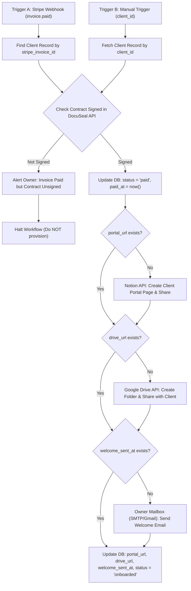

# Workflow Specification: WF-02 — Paid to Provision & Welcome

## 1. Overview & Purpose

**WF-02** executes the onboarding sequence once an initial deposit has been paid and the service agreement has been executed.

* **Triggers**:
  1. **Stripe Webhook**: `invoice.paid` event.
  2. **Manual Trigger**: Manual execution in n8n supplying `{ "client_id": "..." }` for retry/recovery.
* **Outputs**:
  * Contract signature verified in DocuSeal.
  * Database updated with `paid_at` and `status = "paid"`.
  * Notion Client Portal provisioned and shared with client email.
  * Google Drive shared folder created and shared with client email.
  * Welcome email dispatched from owner mailbox (Gmail / SMTP).
  * Database updated with `portal_url`, `drive_url`, `welcome_sent_at`, and `status = "onboarded"`.
* **Idempotency**: Every provisioning side effect is guarded by its own database field (`portal_url`, `drive_url`, `welcome_sent_at`).

---

## 2. Process Flow Diagram

---

## 3. Node-by-Node Specification

### Node 1A: `Trigger_StripeWebhook`
* **Node Type**: `n8n-nodes-base.webhook`
* **Path**: `/webhook/stripe-paid`
* **HTTP Method**: `POST`
* **Verification**: Stripe webhook signature verified via signing secret `{{ $env.STRIPE_WEBHOOK_SECRET }}`.
* **Event Filter**: `event.type === 'invoice.paid'`
* **Extracted Value**: `stripe_invoice_id` = `{{ $json.body.data.object.id }}`

### Node 1B: `Trigger_ManualExecution`
* **Node Type**: `n8n-nodes-base.manualTrigger`
* **Parameters**: Accepts manual input payload `{ "client_id": "rec_..." }`.

### Node 2: `DB_LookupClientRecord`
* **Node Type**: Airtable / Notion Node
* **Operation**: Search / Get Record
* **Filter**:
  * Branch A: Search where `stripe_invoice_id == {{ $json.stripe_invoice_id }}`
  * Branch B: Get by `id == {{ $json.client_id }}`
* **Output Payload**: Complete `clients` record.

### Node 3: `DocuSeal_CheckSignatureStatus`
* **Node Type**: `n8n-nodes-base.httpRequest`
* **Method**: `GET`
* **URL**: `https://api.docuseal.com/submissions/{{ $json.docuseal_submission_id }}`
* **Headers**:
  * `X-Auth-Token`: `={{ $env.DOCUSEAL_API_KEY }}`
* **Output**: Inspects `submitters[0].status` and `status`.

### Node 4: `Gate_VerifySignature`
* **Node Type**: `n8n-nodes-base.if`
* **Condition**: `{{ $json.status }} === 'completed'` OR `{{ $node.DB_LookupClientRecord.json.signed_at }} is not empty`
* **False Branch (Unsigned)**:
  * Triggers notification node: Dispatches warning to alert channel:
    `⚠️ [WF-02 Gate] Client {{ $node.DB_LookupClientRecord.json.name }} paid invoice but DocuSeal contract {{ $node.DB_LookupClientRecord.json.docuseal_submission_id }} is not signed. Provisioning stopped.`
  * Terminates execution immediately.

### Node 5: `DB_RecordPaid`
* **Node Type**: Airtable / Notion Node
* **Operation**: Update Record
* **Target Record**: `id == {{ $node.DB_LookupClientRecord.json.id }}`
* **Fields**:
  * `status`: `paid`
  * `paid_at`: `{{ $now.toISO() }}`
  * `signed_at`: `{{ $node.DB_LookupClientRecord.json.signed_at || $now.toISO() }}`

### Node 6: `Guard_NotionPortal`
* **Node Type**: `n8n-nodes-base.if`
* **Condition**: `{{ $node.DB_LookupClientRecord.json.portal_url }} is not empty`
* **True Branch**: Skips to Node 8 (`Guard_GoogleDrive`).
* **False Branch**: Calls Node 7 (`Notion_CreateClientPortal`).

### Node 7: `Notion_CreateClientPortal`
* **Node Type**: `n8n-nodes-base.notion` / HTTP Request
* **Resource**: Page
* **Operation**: Create
* **Parameters**:
  * Parent Page ID: `={{ $env.NOTION_PARENT_PORTALS_PAGE_ID }}`
  * Title: `{{ $node.DB_LookupClientRecord.json.company }} — Client Portal`
  * Content: Rendered blocks from `templates/notion/client-portal-template.md`.
* **Output**: Extracts `portal_url` = `{{ $json.url }}`.

### Node 8: `Guard_GoogleDrive`
* **Node Type**: `n8n-nodes-base.if`
* **Condition**: `{{ $node.DB_LookupClientRecord.json.drive_url }} is not empty`
* **True Branch**: Skips to Node 10 (`Guard_WelcomeEmail`).
* **False Branch**: Calls Node 9 (`GoogleDrive_CreateAndShareFolder`).

### Node 9: `GoogleDrive_CreateAndShareFolder`
* **Node Type**: `n8n-nodes-base.googleDrive`
* **Operation**: Folder Create & Share
* **Parameters**:
  * Name: `{{ $node.DB_LookupClientRecord.json.company }} - Shared Assets`
  * Parent Folder: `={{ $env.GOOGLE_DRIVE_PARENT_FOLDER_ID }}`
  * Share With: `{{ $node.DB_LookupClientRecord.json.email }}`
  * Role: `writer` (or `commenter`)
* **Output**: Extracts `drive_url` = `{{ $json.webViewLink }}`.

### Node 10: `Guard_WelcomeEmail`
* **Node Type**: `n8n-nodes-base.if`
* **Condition**: `{{ $node.DB_LookupClientRecord.json.welcome_sent_at }} is not empty`
* **True Branch**: Skips to Node 12 (`DB_UpdateOnboarded`).
* **False Branch**: Calls Node 11 (`Mailbox_SendWelcomeEmail`).

### Node 11: `Mailbox_SendWelcomeEmail`
* **Node Type**: `n8n-nodes-base.emailSend` / `n8n-nodes-base.gmail`
* **Parameters**:
  * From: `={{ $env.OWNER_EMAIL }}`
  * To: `={{ $node.DB_LookupClientRecord.json.email }}`
  * Subject: `Welcome to {{ $env.OWNER_COMPANY }} — Onboarding & Next Steps`
  * Body (Plain Text): Interpolated template from `templates/emails/welcome.md`:
    * `{{CLIENT_NAME}}` $\rightarrow$ `{{ $node.DB_LookupClientRecord.json.name }}`
    * `{{COMPANY_NAME}}` $\rightarrow$ `{{ $node.DB_LookupClientRecord.json.company }}`
    * `{{PORTAL_URL}}` $\rightarrow$ `{{ $node.Notion_CreateClientPortal.json.url || $node.DB_LookupClientRecord.json.portal_url }}`
    * `{{DRIVE_URL}}` $\rightarrow$ `{{ $node.GoogleDrive_CreateAndShareFolder.json.webViewLink || $node.DB_LookupClientRecord.json.drive_url }}`
    * `{{BOOKING_LINK}}` $\rightarrow$ `{{ $env.BOOKING_LINK }}`
    * `{{PASSWORD_MANAGER_LINK}}` $\rightarrow$ `{{ $env.PASSWORD_MANAGER_LINK }}`

### Node 12: `DB_UpdateOnboarded`
* **Node Type**: Airtable / Notion Node
* **Operation**: Update Record
* **Target Record**: `id == {{ $node.DB_LookupClientRecord.json.id }}`
* **Fields to Update**:
  * `portal_url`: `={{ $node.Notion_CreateClientPortal.json.url || $node.DB_LookupClientRecord.json.portal_url }}`
  * `drive_url`: `={{ $node.GoogleDrive_CreateAndShareFolder.json.webViewLink || $node.DB_LookupClientRecord.json.drive_url }}`
  * `welcome_sent_at`: `={{ $now.toISO() }}`
  * `status`: `onboarded`

---

## 4. Error Handling Hooks

* Configured with **WF-ERR** as the Error Workflow.
* Critical API steps (DocuSeal, Notion, Google Drive, Mailbox) configured with 3 retries and 2-second backoff.
