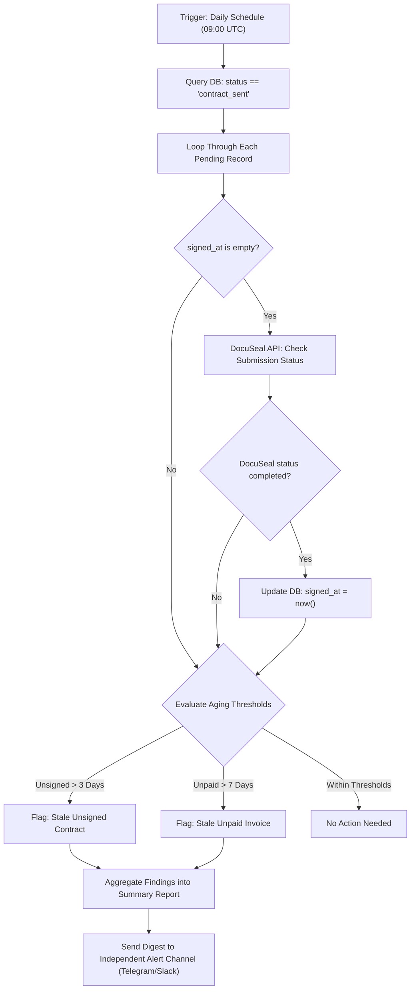

# Workflow Specification: WF-03 — Daily Watcher

## 1. Overview & Purpose

**WF-03** is a daily background audit process that monitors pending client contracts and unpaid invoices. It operates in a strictly **read-only** mode with respect to external clients—it alerts the owner directly and **never** contacts clients or provisions resources automatically.

* **Trigger**: Scheduled Cron Trigger running daily (e.g., 09:00 UTC).
* **Core Responsibilities**:
  1. Identifies records where `status == "contract_sent"`.
  2. Queries the DocuSeal REST API to detect newly completed signatures and records `signed_at`.
  3. Evaluates aging against thresholds (`REMINDER_UNSIGNED_DAYS` and `REMINDER_UNPAID_DAYS`).
  4. Dispatches a consolidated reminder report to the owner via the independent alert channel (Telegram/Slack).

---

## 2. Process Flow Diagram



---

## 3. Node-by-Node Specification

### Node 1: `Trigger_DailySchedule`
* **Node Type**: `n8n-nodes-base.scheduleTrigger`
* **Parameters**:
  * Trigger Interval: Days
  * Time: `09:00`
  * Timezone: UTC

### Node 2: `DB_FindPendingContracts`
* **Node Type**: Airtable / Notion Node
* **Operation**: List / Search Records
* **Filter**: `status` equals `contract_sent`
* **Output**: Array of client records pending signature or payment.

### Node 3: `DocuSeal_SyncSignature`
* **Node Type**: `n8n-nodes-base.httpRequest`
* **Method**: `GET`
* **URL**: `https://api.docuseal.com/submissions/{{ $json.docuseal_submission_id }}`
* **Headers**:
  * `X-Auth-Token`: `={{ $env.DOCUSEAL_API_KEY }}`
* **Condition**: Run only if record's `signed_at` is empty.

### Node 4: `DB_UpdateSignedAt`
* **Node Type**: Airtable / Notion Node
* **Condition**: If DocuSeal returns `status === 'completed'` and `signed_at` was previously empty.
* **Operation**: Update Record
* **Target**: `id == {{ $json.client_id }}`
* **Fields**:
  * `signed_at`: `{{ $json.audit_log_url ? $now.toISO() : $json.updated_at }}`

### Node 5: `Code_EvaluateAging`
* **Node Type**: Code Node (JavaScript)
* **Parameters**:
  ```javascript
  const now = new Date();
  const unsignedThresholdDays = parseInt(process.env.REMINDER_UNSIGNED_DAYS || '3', 10);
  const unpaidThresholdDays = parseInt(process.env.REMINDER_UNPAID_DAYS || '7', 10);

  const alerts = [];

  for (const item of $input.all()) {
    const data = item.json;
    const createdAt = new Date(data.created_at);
    const ageDays = Math.floor((now - createdAt) / (1000 * 60 * 60 * 24));
    
    const isUnsigned = !data.signed_at;
    const isUnpaid = !data.paid_at;

    if (isUnsigned && ageDays >= unsignedThresholdDays) {
      alerts.push({
        type: 'UNSIGNED_CONTRACT',
        client: data.name,
        company: data.company,
        age_days: ageDays,
        submission_id: data.docuseal_submission_id
      });
    }

    if (isUnpaid && ageDays >= unpaidThresholdDays) {
      alerts.push({
        type: 'UNPAID_INVOICE',
        client: data.name,
        company: data.company,
        age_days: ageDays,
        invoice_url: data.stripe_invoice_url
      });
    }
  }

  if (alerts.length === 0) {
    return [];
  }

  return [{ json: { count: alerts.length, items: alerts } }];
  ```

### Node 6: `Alert_SendDigest`
* **Node Type**: Telegram / Slack Node (`n8n-nodes-base.telegram` or `n8n-nodes-base.slack`)
* **Condition**: Runs only if `alerts.length > 0`.
* **Message Payload (Markdown)**:
  ```text
  📬 *Daily Client Follow-up Digest*
  
  Found {{ $json.count }} items requiring attention:
  
  {{ $json.items.map(a => `• [${a.type}] *${a.company}* (${a.client}) — Pending ${a.age_days} days`).join('\n') }}
  
  👉 Chase directly via owner mailbox or phone.
  ```

---

## 4. Operational Boundaries

* **No Direct Client Outreach**: WF-03 never emails clients directly. The owner maintains full relationship control and decides when and how to follow up.
* **Zero Resource Provisioning**: Never calls Notion, Google Drive, or Stripe payment settlement endpoints.
* **Idempotent Polling**: Re-running WF-03 multiple times per day produces zero unintended state changes.
