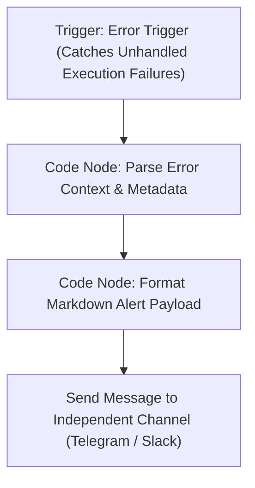

# Workflow Specification: WF-ERR — Error Alert

## 1. Overview & Purpose

**WF-ERR** is the centralized exception handler for the Lean Client Onboarding System. When any node in an active automation fails after exhausting its internal retry attempts, n8n invokes this error workflow.

* **Trigger**: `Error Trigger` node (`n8n-nodes-base.errorTrigger`).
* **Output**: Formatted urgent notification dispatched to an out-of-band channel (Telegram Bot or Slack Webhook).
* **Guards**: Designed to never fail recursively or trigger secondary error loops.

---

## 2. Process Flow Diagram



---

## 3. Node-by-Node Specification

### Node 1: `Trigger_ErrorTrigger`
* **Node Type**: `n8n-nodes-base.errorTrigger`
* **Incoming Data Structure**:
  * `execution`: Execution ID, URL, retry count.
  * `workflow`: Workflow name, workflow ID.
  * `node`: Name of failed node, node type.
  * `error`: Error message, stack trace, status code.

### Node 2: `Code_ParseErrorContext`
* **Node Type**: Code Node (JavaScript)
* **Parameters**:
  ```javascript
  const input = $input.item.json;

  const workflowName = input.workflow?.name || 'Unknown Workflow';
  const workflowId = input.workflow?.id || 'N/A';
  const nodeName = input.node?.name || 'Unknown Node';
  const executionId = input.execution?.id || 'N/A';
  const errorMessage = input.execution?.error?.message || input.error?.message || 'No error message provided';
  const timestamp = new Date().toISOString();

  // Extract client identifier if present in the failed execution payload
  let clientId = 'N/A';
  if (input.execution?.data?.resultData?.runData) {
    const runData = input.execution.data.resultData.runData;
    for (const nodeKey of Object.keys(runData)) {
      const nodeExec = runData[nodeKey];
      if (nodeExec[0]?.data?.main?.[0]?.[0]?.json?.id) {
        clientId = nodeExec[0].data.main[0][0].json.id;
        break;
      }
    }
  }

  return [{
    json: {
      workflowName,
      workflowId,
      nodeName,
      executionId,
      errorMessage,
      timestamp,
      clientId
    }
  }];
  ```

### Node 3: `Dispatch_IndependentAlert`
* **Node Type**: `n8n-nodes-base.telegram` OR `n8n-nodes-base.slack` / `n8n-nodes-base.httpRequest`
* **Authentication**: Dedicated bot token or incoming webhook URL independent of the client-facing mail or database channels.
* **Notification Content (Markdown)**:
  ```text
  🚨 *Automation Incident Alert*
  
  • *Workflow*: `{{ $json.workflowName }}`
  • *Failed Node*: `{{ $json.nodeName }}`
  • *Client ID*: `{{ $json.clientId }}`
  • *Time*: `{{ $json.timestamp }}`
  • *Execution ID*: `{{ $json.executionId }}`
  
  *Error Details*:
  ```
  {{ $json.errorMessage }}
  ```
  
  👉 Check n8n execution log and follow runbook procedures in `docs/runbook.md`.
  ```

---

## 4. Setup in Workflows

To attach this error handler to the core workflows:
1. Open **WF-01**, **WF-02**, or **WF-03** in n8n.
2. In Workflow Settings (top menu $\rightarrow$ **Settings**):
   * Set **Error Workflow** to `WF-ERR: Error Alert`.
3. Save and activate the workflow.
